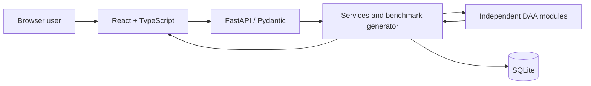

# Minor Project Proposal

## Project title
**Emergency Relief Resource Allocation and Route Optimization System**

Academic Year 2026–27 · SY B.Tech CSE · DAA · team of five · Python/FastAPI and React/TypeScript web application.

## Abstract
The proposed web workbench demonstrates how algorithm strategies can support resource allocation and route planning in manually entered disaster scenarios. It implements Merge Sort, Fractional Knapsack, 0/1 Knapsack, Dijkstra, Bellman-Ford and TSP Branch and Bound. A browser GUI calls a Python API; SQLite stores scenarios, locations, inventory, road networks and algorithm measurements. The prototype does not ingest live disaster data or replace emergency response authorities.

## Problem statement and objectives
Multiple affected locations can have different urgency and resource demand while stock and vehicle capacity are limited. A weighted road graph may contain inaccessible or one-way roads. The project demonstrates how to sort requests, allocate divisible and indivisible resources, calculate shortest paths and optimize a small closed delivery tour.

Objectives are to create a browser-based interface; persist user data; implement and compare DAA algorithms independently; present actual results and measurements; document correctness, complexity and limitations; and prepare the team to explain the full design.

## Existing approach and research gap
Manual spreadsheets and map-assisted planning can work for small cases but make algorithm choices and comparison difficult to inspect. This project is an educational integration and visualization, not a new optimization method or a field study. Its value is to expose algorithm assumptions and outputs in one reproducible workbench.

## Methodology
Create a scenario; enter locations, demands, resources and directed non-negative road costs; validate inputs; execute the selected Python implementation; persist inputs/output/time; compare against appropriate baselines; inspect measured results and theoretical complexity separately; export scenario results.

## DAA strategies

- **Divide and Conquer:** Stable Merge Sort for user-supplied values/keys; O(n log n) time, O(n) auxiliary memory.
- **Greedy:** Fractional Knapsack ordered by value/weight ratio; O(n log n), divisible quantities only.
- **Dynamic Programming:** Full-table 0/1 Knapsack; O(nW) time and space for integer capacity, pseudo-polynomial.
- **Graph Algorithms:** Dijkstra with adjacency list/min-heap, non-negative weights; O((V+E) log V). Bellman-Ford comparison supports negative edges and detects reachable negative cycles in O(VE).
- **Branch and Bound:** Exact TSP for at most ten locations, symmetric MST bound and asymmetric outgoing-edge relaxation; O(n!) worst case.

## Database and implementation
Normalized SQLite tables cover scenarios, affected locations, resource types/stock, demands, road nodes/edges, algorithm runs, allocation/route results and benchmark runs/measurements. See `docs/ARCHITECTURE.md`. Existing root algorithm modules are reused through thin backend adapters; the former desktop prototype stays separate.

## Evaluation
The Python test suite covers algorithms, API route functions, persistence and benchmark records. Fixed-seed benchmark generation records repeated timings, median/mean, input size, software/platform metadata. Actual screenshot and browser integration evidence must be added after installing frontend packages and launching both local processes.

## Team details
Insert student names and PRNs in `docs/TEAM_MEMBER_CONTRIBUTIONS.md`. The role split is proposed; members must record their actual verified contributions.

## Limitations and future scope
Static manual inputs; no live maps, weather, traffic, inventory sources, multi-vehicle constraints or dispatch authority. Future scope includes geographic road data, demand fairness, multiple vehicles/depots and deployment after suitable operational validation.

## References
1. T. H. Cormen, C. E. Leiserson, R. L. Rivest, and C. Stein, *Introduction to Algorithms*, 4th ed. Cambridge, MA: MIT Press, 2022.
2. J. Kleinberg and É. Tardos, *Algorithm Design*. Boston, MA: Pearson, 2005.
3. E. W. Dijkstra, “A note on two problems in connexion with graphs,” *Numerische Mathematik*, vol. 1, pp. 269–271, 1959.
4. R. Bellman, “On a routing problem,” *Quarterly of Applied Mathematics*, vol. 16, no. 1, pp. 87–90, 1958.

**College formatting:** `Guidelines_For_Minor_Project_DAA(2).pdf` was not present in the workspace. Confirm cover matter, declarations, figure order and print requirements against the supplied college copy before submission.
