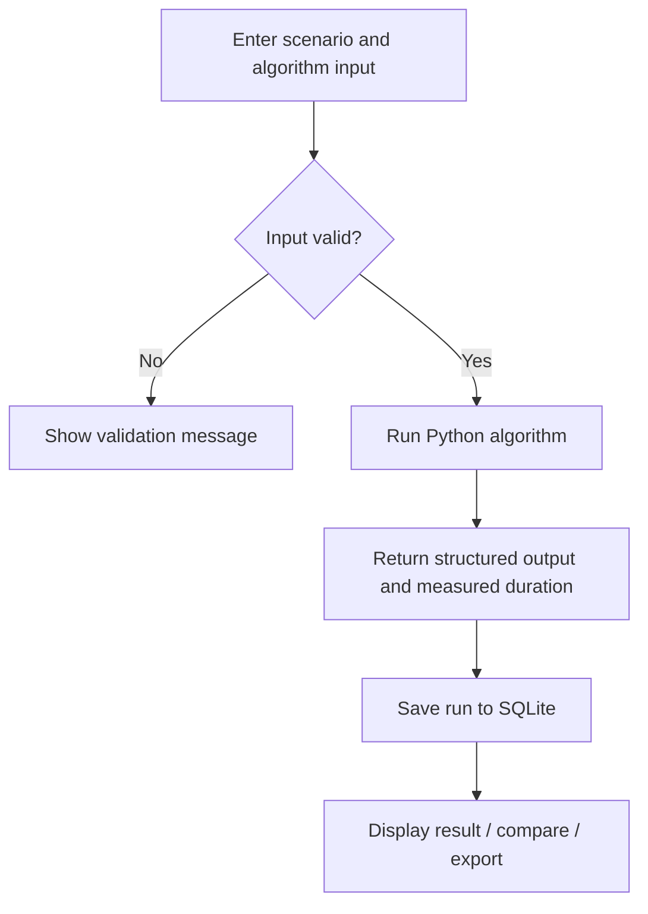

# Emergency Relief Resource Allocation and Route Optimization System

**Course:** Design and Analysis of Algorithms  
**Academic year:** 2026–27  
**Programme:** SY B.Tech CSE  
**Team size:** Five students  
**Team member names / PRNs:** To be supplied by the team  
**Project guide / division:** To be completed  
**Report format:** A4; final college-specific layout must be checked against `Guidelines_For_Minor_Project_DAA(2).pdf`, which was unavailable in the workspace.

## 1. Title page and team details

Use the actual college cover sheet. Enter the five student names, PRNs, division, guide, academic year and submission date. Proposed roles are listed in `TEAM_MEMBER_CONTRIBUTIONS.md`; students must confirm their actual contributions.

## 2. Abstract

This project is a browser-based educational workbench for exploring algorithmic decisions in relief resource allocation and route planning. It includes independent Python implementations of Merge Sort, Fractional Knapsack, 0/1 Knapsack, Dijkstra, Bellman-Ford and exact TSP Branch and Bound. A React/TypeScript frontend calls FastAPI endpoints; SQLite persists scenarios, locations, inventory, directed-road networks and experiment data. Two India-themed scenarios are preloaded for demonstration, with every quantity and road cost explicitly marked illustrative. A separate live-data page retrieves model-based weather for searched Indian places. The website is an academic prototype, not an emergency dispatch system or official alert service. The Python suite reports 38 passing checks and the frontend production build succeeds; live operational use and field data are not claimed.

## 3. Introduction

Disaster-relief planning can involve many locations with different priorities and demand while limited stock must be carried through a road network. DAA concepts provide rigorous ways to study sorting, selection and path costs. This project places these distinct formulations in a browser workbench so inputs, outputs and assumptions can be discussed and reproduced.

## 4. Problem statement

Given manually recorded affected locations, relief stock, capacity and directed road distances, demonstrate how selected DAA methods prioritize requests, allocate resources, calculate shortest paths and find a low-cost closed delivery tour for a small instance. The system must preserve data and explain why algorithm assumptions matter.

## 5. Objectives

1. Develop a browser-based GUI connected to a Python API.
2. Persist scenarios, locations, demands, inventory and road networks in SQLite.
3. Implement core algorithms independently and validate their results.
4. Compare each exact/efficient method with an appropriate baseline on shared inputs.
5. Show actual saved outputs and measured times separately from theoretical complexity.
6. Prepare reproducible documentation and viva material for a five-member team.

## 6. Literature review / existing approaches

Spreadsheet inventory, manual prioritization and map-assisted routing can be practical for small cases. They do not always expose the formal trade-offs of divisible versus indivisible goods, shortest-path assumptions or exponential tour search. This project is an academic integration and does not claim a new algorithm or field-tested improvement.

## 7. Proposed methodology

Create a scenario, enter locations and their priority/demand, record inventory, create a directed weighted graph, validate inputs, execute the selected Python algorithm, persist inputs and results, compare against an appropriate baseline, inspect actual measurements and export a scenario summary. Example values are illustrative and must be identified as such.

## 8. Selected DAA strategies and algorithms

- Divide and Conquer: Merge Sort for stable ordering.
- Greedy: Fractional Knapsack for divisible resources only.
- Dynamic Programming: 0/1 Knapsack for whole packages with integer capacity.
- Graph Algorithms: Dijkstra on non-negative edge weights; Bellman-Ford for negative edges and negative-cycle detection.
- Branch and Bound: exact small-instance TSP with admissible lower bounds and pruning.

## 9. Algorithm pseudocode

### Merge Sort
```text
sort(A):
  if length(A) <= 1: return A
  split A into L and R
  return stable_merge(sort(L), sort(R))
```

### Fractional Knapsack
```text
stable-sort supplies by descending value / weight
for supply in order:
  take min(1, remaining_capacity / supply.weight)
  add proportional value and used capacity
```

### 0/1 Knapsack
```text
DP[0][c] = 0
for item i = 1..n:
  for c = 0..W:
    if item fits: DP[i][c] = max(exclude, include + previous state)
    else: DP[i][c] = DP[i-1][c]
trace table backward to recover selected items
```

### Dijkstra
```text
initialize source distance to zero, other distances to infinity
push source into min-heap
while heap not empty:
  settle smallest valid entry
  relax each outgoing edge and update predecessor on improvement
```

### Branch-and-Bound TSP
```text
search(path, cost):
  bound = admissible lower bound for every completion of path
  if bound >= best complete tour: prune
  else if every node visited: close tour and update best
  else recurse for each reachable unvisited node
```

## 10. Flowcharts



## 11. System architecture

React + TypeScript + Vite presents pages and calls FastAPI. Pydantic validates request inputs. Services invoke the preserved, independent Python modules and write actual outputs/timings to SQLite. Recharts renders saved benchmark measurements; React Flow displays saved road nodes/edges and latest saved Dijkstra path. See `ARCHITECTURE.md`.

## 12. Database design

`disaster_scenarios` owns `affected_locations`, `resource_inventory`, `road_nodes`, `road_edges` and optionally linked `algorithm_runs`. `resource_types` defines units and value/weight assumptions; `location_demands` references location and resource type. `allocation_results` and `route_results` extend algorithm runs. `benchmark_runs` and `benchmark_measurements` store generated inputs' seed/size and repeated timings. Foreign keys and checks are enabled. No sample rows are inserted at server startup; `python -m backend.seed_demo` explicitly restores the two presentation scenarios.

## 13. Implementation details

- The existing algorithm modules remain in root `app/algorithms/`; `backend/app/algorithms/` contains adapters, not duplicate logic.
- FastAPI routers provide health, dashboard, scenario/location/inventory/road CRUD, algorithm execution/comparisons, benchmarks, run history and CSV/PDF summary endpoints.
- SQLite initializes with `CREATE TABLE IF NOT EXISTS` and additive migrations.
- The React app uses one responsive sidebar shell with dedicated pages for overview, scenarios, affected locations, India live weather, inventory, allocation, road network, route optimization, delivery tour, algorithm explorer, performance and reports.
- The desktop PySide6 prototype remains separate at root `app/ui/` and `main.py`.

## 14. GUI screenshots

The production frontend build succeeds. Screenshots should be captured from the local browser after starting the backend and frontend, as browser-side access is not available in this report-writing run.

## 15. Test cases and actual outputs

Latest Python run: **38 passed** with `python -m pytest -q --basetemp='.pytest-tmp'`; `compileall` succeeded. Coverage includes algorithm boundary/correctness checks, brute-force comparisons, persistence, benchmark records, direct FastAPI route-function checks, saved-network tour solving and OpenAPI route registration. This verifies the Python algorithm and route-function layer, not operational emergency use.

| Check | Verified result |
|---|---|
| Core algorithm unit suite | Pass; see `TEST_REPORT.md` |
| API route functions and SQLite persistence | Pass through synchronous route checks |
| Selected local HTTP endpoints | Dashboard and India weather lookup returned data |
| Frontend typecheck and production build | Pass; Vite emitted production assets |
| Browser graph/charts/report download | Must be checked during the local presentation |

Add actual input/output screenshots and execution environment details after local demo runs.

## 16. Time complexity analysis

| Algorithm | Best / average / worst |
|---|---|
| Merge Sort | O(n log n) / O(n log n) / O(n log n) |
| Fractional Knapsack including sort | O(n log n) / O(n log n) / O(n log n) |
| 0/1 Knapsack full table | O(nW) / O(nW) / O(nW) |
| Dijkstra binary heap | O((V+E) log V) / same / same |
| Bellman-Ford early exit | O(E) favorable case / O(VE) / O(VE) |
| TSP Branch and Bound | Bound/input dependent / bound/input dependent / O(n!) |

`n` is item/value count; `W` integer capacity; `V` graph vertices; `E` directed edges. 0/1 Knapsack is pseudo-polynomial. TSP can still explore factorially many tours.

## 17. Space complexity analysis

Merge Sort O(n); Fractional Knapsack O(n); full-table 0/1 Knapsack O(nW); Dijkstra O(V) algorithm state plus O(V+E) graph storage; Bellman-Ford O(V) state; TSP uses O(n) recursion plus a potentially exponential event/search log. Event capture adds memory proportional to events.

## 18. Algorithm comparisons

The UI/API compare Merge Sort with insertion sort, Fractional Knapsack with first-fit, 0/1 DP with exhaustive subsets, Dijkstra with Bellman-Ford on the same non-negative graph, and TSP Branch and Bound with exhaustive enumeration on the same matrix. Fractional and 0/1 formulations are not interchangeable. Each measured time is tied to the actual input, seed and environment.

## 19. Performance observations

No universal measured-performance claim is made. The Performance Lab generates fixed-seed inputs, performs one warm-up, records repeated `perf_counter` durations and persists median, mean, seed, size, Python version and platform. The demonstration database contains one small Merge Sort benchmark (n=80); collect more sizes and algorithms before making broader performance observations.

## 20. Limitations

No live hazard-alert, map, road-network, traffic or inventory integrations. Optional model-based weather context is retrieved for Indian places through Open-Meteo. Directed route distances remain manually entered; no multi-vehicle, multi-depot or time-window constraints; exact TSP capped at ten nodes; no operational field validation. This is not a certified dispatch system.

## 21. Conclusion

The implementation connects the selected DAA strategies to one browser-based planning workflow while preserving their mathematical distinctions. Python checks and the frontend production build pass, and selected local HTTP routes have returned data. A full visual browser walkthrough remains before submission.

## 22. Future scope

Verified geographic data, multiple vehicles/depots, delivery deadlines, fair allocation constraints, validated external APIs and deployment only after safety and operational review.

## 23. References

1. T. H. Cormen, C. E. Leiserson, R. L. Rivest, and C. Stein, *Introduction to Algorithms*, 4th ed. Cambridge, MA: MIT Press, 2022.
2. J. Kleinberg and É. Tardos, *Algorithm Design*. Boston, MA: Pearson, 2005.
3. E. W. Dijkstra, “A note on two problems in connexion with graphs,” *Numerische Mathematik*, vol. 1, pp. 269–271, 1959.
4. R. Bellman, “On a routing problem,” *Quarterly of Applied Mathematics*, vol. 16, no. 1, pp. 87–90, 1958.
5. FastAPI documentation, https://fastapi.tiangolo.com/.
6. React documentation, https://react.dev/.
7. Vite documentation, https://vite.dev/.
8. shadcn/ui documentation, https://ui.shadcn.com/.
9. Recharts documentation, https://recharts.org/.
10. React Flow documentation, https://reactflow.dev/.

## 24. Appendices and contribution record

Viva questions, algorithm explanations, demonstration script and member contribution placeholders are provided in the adjacent docs. Add team names/PRNs and confirm each contribution with the students. Apply college cover pages, declarations, signatures and section order only after reviewing the exact college guideline PDF.
